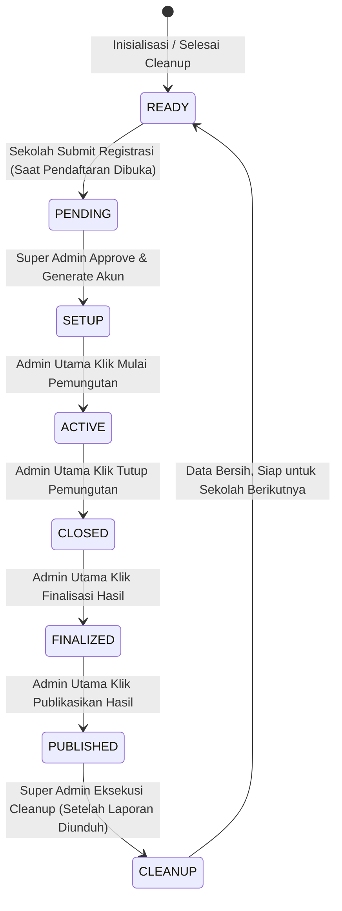

# PRD: Platform E-Voting Sekolah (Single-Tenant Sequential)

**Status:** Final Approved Technical Specification

**Stack:** React.js (Frontend), CodeIgniter 4 (Backend API), PostgreSQL (Neon Database)

**Hosting:** Vercel (Frontend), Neon PostgreSQL (Database)

---

## 1. Tujuan dan Ruang Lingkup

### 1.1 Tujuan
Menyediakan aplikasi *e-voting* untuk pemilihan di sekolah (seperti Pemilihan Ketua OSIS) yang digunakan oleh **satu sekolah dalam satu waktu** (*single-tenant sequential*). Setelah seluruh rangkaian acara selesai dan laporan diunduh, seluruh data operasional dihapus (*cleanup*) sehingga aplikasi kembali bersih dan siap digunakan oleh sekolah berikutnya.

### 1.2 Di Dalam Ruang Lingkup (Versi 1)
- Pendaftaran sesi oleh sekolah dan persetujuan oleh Super Admin (KPU).
- Pembuatan 5 akun admin sekolah otomatis (1 Akun Utama, 4 Akun Pendukung).
- Pengiriman kredensial akun panitia secara manual oleh Super Admin via WhatsApp dan/atau Email.
- Manajemen DPT (impor CSV, preview, validasi ganda) dan kandidat (profil, foto 500x500) oleh Admin Sekolah.
- **Verifikasi Mandiri Siswa via Smartphone:** Siswa cek DPT dan verifikasi mandiri menggunakan NISN + Tanggal Lahir (format DDMMYYYY) untuk mendapatkan QR Code & Token 6 Karakter.
- **Bilik Suara (Kiosk Mode):** Pemungutan suara terpusat di laptop bilik sekolah menggunakan webcam scan QR Code dengan *fallback* input manual kode token 6 digit.
- **Realcount Publik Terbatas:** Tampilan live partisipasi pemilih (*turnout*) selama pemungutan berlangsung, tanpa menampilkan perolehan angka kandidat.
- Finalisasi hasil, publikasi hasil resmi, dan unduh laporan resmi (PDF & CSV).
- *Cleanup* data otomatis oleh Super Admin dengan pengaman berlapis.
- Audit log menyeluruh untuk aktivitas administratif.

### 1.3 Di Luar Ruang Lingkup (Ditunda ke Versi 2)
- Multi-sekolah berjalan bersamaan (*multi-tenant simultaneous*).
- Pengiriman otomatis kredensial akun via gateway WhatsApp API / SMTP Email otomatis.
- **Pemilih Remote / Jarak Jauh:** Ditunda ke rilis berikutnya. Versi 1 fokus 100% pada bilik laptop fisik di lingkungan sekolah.

---

## 2. Peran dan Hak Akses (Role-Based Access Control)

| Peran | Role di Sistem | Hak Akses | Batasan Kritis |
| :--- | :--- | :--- | :--- |
| **Super Admin (KPU)** | `super_admin` | Buka/tutup form pendaftaran, review pendaftaran sekolah, approve & generate 5 akun, monitoring progres tahapan, eksekusi data *cleanup*. | **DILARANG KERAS** mengakses data operasional pemilu (DPT, kandidat, bilik, suara, dan rincian hasil pemilu). Mendapat respon HTTP 403 jika mencoba mengakses. |
| **Admin Utama Sekolah** | `admin_sekolah` (`is_primary = true`) | Seluruh manajemen pemilu sekolah: impor & kunci DPT, CRUD & kunci kandidat, atur jadwal, serta **hak eksklusif** transisi status kritis: `Mulai Pemungutan`, `Tutup Pemungutan`, `Finalisasi Hasil`, dan `Publikasikan Hasil`. | Wajib mengetik teks konfirmasi persis `TUTUP SESI PEMUNGUTAN` saat menutup sesi. |
| **Admin Pendukung Sekolah** | `admin_sekolah` (`is_primary = false`) | Membantu entri data: cek data DPT, input/review kandidat, pantau kendala operasional. | **DILARANG** melakukan transisi status pemilu (`Mulai`, `Tutup`, `Finalisasi`, `Publikasi`). Tombol-tombol ini di-disable di UI dan dilindungi middleware di backend. |
| **Pemilih (Siswa)** | *Tanpa Akun* | Cek DPT, verifikasi mandiri via HP untuk memperoleh QR Code/Token, melihat profil kandidat, melihat jadwal & realcount partisipasi publik, dan mencoblos di bilik suara. | Hanya bisa menggunakan token satu kali (*single-use*). |

---

## 3. Siklus Hidup Status Pemilu (Strict Finite State Machine)

Sistem hanya mengizinkan satu sesi pemilu aktif. Status sesi di tabel `elections` berpindah **maju searah secara berurutan** dan dilarang melompat atau mundur (kecuali saat *cleanup*):



### Detail Aturan Transisi:
1. **`READY`**: Sistem kosong. Super Admin memiliki toggle `is_registration_open` (buka/tutup pendaftaran publik).
2. **`PENDING`**: Sekolah mengisi form registrasi. Menunggu review KPU.
3. **`SETUP`**: KPU klik `[Approve & Generate]`. Dibuat 5 akun admin. Panitia menyiapkan DPT, kandidat, dan jadwal.
4. **`ACTIVE`**: DPT dan kandidat telah dikunci. Pemungutan suara berlangsung di bilik laptop. Realcount partisipasi aktif di halaman publik.
5. **`CLOSED`**: Pemungutan ditutup oleh Admin Utama dengan konfirmasi teks. Bilik suara terkunci otomatis. Token tidak dapat digunakan lagi.
6. **`FINALIZED`**: Panitia mengunci hasil setelah memeriksa Status Integritas Data. Data pemilu menjadi *immutable* (tidak dapat diubah lagi).
7. **`PUBLISHED`**: Hasil perolehan suara masing-masing kandidat dibuka ke publik di halaman Hasil Pemilihan.
8. **`CLEANUP`**: Super Admin mengeksekusi penghapusan seluruh data operasional dengan konfirmasi teks `HAPUS DATA`. Tombol ini hanya aktif jika Admin Sekolah sudah mengunduh laporan pemilu. Status kembali ke `READY`.

---

## 4. Arsitektur Data & Keamanan

### 4.1 Prinsip Kerahasiaan Suara Mutlak (*Zero-Knowledge Ballots*)
Tabel `ballots` **sama sekali tidak memiliki relasi atau foreign key** ke tabel `voters` maupun `voting_tokens`, serta tidak mencatat timestamp presisi. Tidak ada query database atau pihak manapun (termasuk developer dan database admin) yang dapat melacak pilihan siswa tertentu.

### 4.2 Skema Tabel Utama
* **`elections`**:
  * `id` (PK), `status` (Enum: READY, PENDING, SETUP, ACTIVE, CLOSED, FINALIZED, PUBLISHED, CLEANUP)
  * `is_registration_open` (Boolean, default: false)
  * `school_name`, `npsn`, `contact_name`, `contact_phone`, `contact_email`
  * `start_time`, `end_time` (WIB)
  * `dpt_locked_at`, `candidates_locked_at`, `report_downloaded_at`
  * `created_at`, `updated_at`
* **`users`**:
  * `id` (PK), `name`, `username`/`email`, `password_hash`
  * `role` (`super_admin` / `admin_sekolah`)
  * `is_primary` (Boolean: true untuk Admin Utama, false untuk 4 Admin Pendukung)
  * `election_id` (FK nullable)
* **`voters`**:
  * `id` (PK), `nisn` (String unik per sesi), `name`, `class`, `birth_date` (Date)
  * `has_voted` (Boolean, default: false)
  * `voted_at` (Date only / dibulatkan)
* **`candidates`**:
  * `id` (PK), `number` (Integer, nomor urut unik)
  * `name`, `photo_url`, `vision`, `mission`, `program`
* **`voting_tokens`**:
  * `id` (PK), `token` (String 6 karakter unik dengan prefix `TKN-XXXXXX`, tanpa karakter ambigu 0/O, 1/I)
  * `voter_id` (FK ke `voters`)
  * `status` (Enum: `unused`, `used`)
  * `created_at`
  * **Aturan Masa Berlaku & Idempotensi:** Token berlaku selama pemilu berstatus `ACTIVE` dan kedaluwarsa saat status berubah menjadi `CLOSED`. Jika pemilih yang sama melakukan verifikasi ulang via HP sebelum memilih, sistem mengembalikan token aktif yang sama (idempoten).
* **`ballots`**:
  * `id` (UUID acak)
  * `candidate_id` (FK ke `candidates`)
  * *Tanpa voter_id, tanpa token_id, tanpa timestamp presisi.*
* **`audit_logs`**:
  * `id` (PK), `user_id` (FK nullable), `action`, `ip_address`, `created_at`

### 4.3 Logika Anti Double-Vote (Backend Concurrency Protection)
Submit suara di bilik laptop wajib dibungkus dalam **Database Transaction** dengan **Pessimistic Locking** (`SELECT ... FOR UPDATE`):
```sql
BEGIN TRANSACTION;
-- 1. Kunci baris token untuk mencegah race condition / klik ganda
SELECT * FROM voting_tokens WHERE token = :token_code FOR UPDATE;

-- 2. Validasi: pastikan token ada, berstatus 'unused', dan status pemilu == 'ACTIVE'
-- (Jika tidak valid, ROLLBACK dan lempar HTTP 422/400)

-- 3. Tandai token telah digunakan
UPDATE voting_tokens SET status = 'used' WHERE id = :token_id;

-- 4. Tandai pemilih telah berpartisipasi
UPDATE voters SET has_voted = true WHERE id = :voter_id;

-- 5. Masukkan surat suara anonim
INSERT INTO ballots (id, candidate_id) VALUES (gen_random_uuid(), :candidate_id);

COMMIT;
```

---

## 5. Fitur Antarmuka & Alur Pengguna

### 5.1 Portal Publik (Tanpa Login)
1. **Beranda**: Banner status pemilu, panduan alur pemilihan, tombol Cek DPT & Info Paslon.
2. **Cek DPT**: Input NISN + Tanggal Lahir (DDMMYYYY). Error message diseragamkan (*"Data tidak ditemukan atau tanggal lahir salah"*) agar NISN tidak bisa ditebak. Dilengkapi IP rate-limiter.
3. **Info Paslon**: Grid foto, nomor urut, visi, misi, dan program kerja.
4. **Jadwal & Tahapan**: Timeline vertikal progres acara pemilu.
5. **Realcount Partisipasi (Live Turnout saat `ACTIVE`)**:
   - Menampilkan total DPT terdaftar, total suara masuk, persentase partisipasi, dan timestamp pembaruan terakhir.
   - **Rincian perolehan angka kandidat TIDAK ditampilkan.**
6. **Hasil Pemilihan (Hanya saat `PUBLISHED`)**:
   - Menu hasil muncul di navbar publik.
   - Menampilkan grafik batang perolehan suara masing-masing paslon, persentase kemenangan, dan total suara sah.

### 5.2 Verifikasi Mandiri Siswa (Mobile Device)
1. Siswa mengakses menu verifikasi via smartphone masing-masing.
2. Memasukkan NISN dan Tanggal Lahir.
3. Sistem memvalidasi ke database. Jika valid dan `has_voted == false`:
   - Sistem menampilkan **QR Code** besar di layar HP siswa.
   - Sistem menampilkan teks cadangan kode token 6 karakter (misal: `8F9A2B`).
   - Instruksi: Siswa membawa HP ke bilik suara laptop untuk discan.
4. Jika halaman tidak sengaja tertutup/refresh, siswa cukup input ulang NISN + DOB untuk melihat kembali QR Code yang sama (selama belum mencoblos).

### 5.3 Bilik Suara (Kiosk Mode di Laptop Panitia)
1. **Antarmuka Layar Penuh (Fullscreen)**: Tanpa URL bar, navbar, atau footer.
2. **Autentikasi Pemilih**:
   - Kamera laptop aktif untuk men-scan QR Code dari layar HP siswa.
   - *Fallback:* Tombol input manual kode token 6 digit jika webcam buram atau layar HP siswa retak.
3. **Surat Suara Digital**: Tampilan kartu paslon dengan nomor urut besar dan foto jelas.
4. **Konfirmasi Pilihan**: Modal dua tahap: *"Anda akan memilih Paslon No. X [Nama]. Apakah Anda yakin?"*.
5. **Selesai & Auto-Reset**: Setelah submit sukses, layar menampilkan ucapan terima kasih dan otomatis kembali ke layar scan dalam **5 detik** tanpa sentuhan panitia.

### 5.4 Dashboard Super Admin (KPU)
- Akses melalui `/admin`.
- Toggle Buka/Tutup Pendaftaran di status `READY`.
- Tabel pengajuan sekolah dengan tombol `[Approve & Generate]`.
- Modal kredensial 5 akun (1 Utama + 4 Pendukung) dengan tombol salin, untuk dikirimkan manual oleh KPU via WhatsApp/Email ke panitia sekolah.
- Monitoring progres tahapan (hanya *progress bar* tahapan, tanpa data sensitif suara).
- Tombol *Cleanup Data* dengan proteksi ganda (laporan wajib sudah diunduh + ketik konfirmasi `HAPUS DATA`).

### 5.5 Dashboard Admin Sekolah
- **Manajemen DPT**: Impor CSV (NISN, Nama, Kelas, Tanggal Lahir), validasi ganda, preview tabel, dan tombol Kunci DPT.
- **Manajemen Kandidat**: Input paslon, upload foto (auto-crop 500x500 WebP/JPG/PNG max 1MB), dan tombol Kunci Kandidat.
- **Pengaturan Jadwal**: Waktu mulai dan selesai (WIB).
- **Kontrol Tahapan (Khusus Admin Utama)**:
  - Tombol `Mulai Pemungutan` (syarat: DPT & Kandidat terkunci, jadwal terisi).
  - Tombol `Tutup Pemungutan` (modal mewajibkan mengetik persis `TUTUP SESI PEMUNGUTAN`).
  - Tombol `Finalisasi Hasil` (kunci data permanen setelah verifikasi integritas).
  - Tombol `Publikasikan Hasil`.
- **Integritas & Laporan**:
  - Widget Integritas Data: Memverifikasi `Total Ballots == Total Voters with has_voted=true`.
  - Tombol Unduh Laporan Resmi format PDF dan CSV.

---

## 6. Keputusan Arsitektur Final (Menjawab Bab 12 Sebelumnya)

1. **Distribusi Akun:** KPU men-generate 5 akun sekaligus di sistem (1 Utama + 4 Pendukung). KPU mendistribusikan kredensial tersebut secara manual via WhatsApp dan/atau Email kepada perwakilan sekolah.
2. **Pemilih Remote:** Resmi ditunda ke Versi 2. Versi 1 fokus 100% pada bilik laptop fisik di sekolah.
3. **Titik Verifikasi:** Mandiri via smartphone masing-masing siswa (mengeliminasi antrean registrasi manual dan biaya cetak kertas).
4. **Kewenangan Admin Pendukung:** Dibatasi ketat. Seluruh transisi status (`Mulai`, `Tutup`, `Finalisasi`, `Publikasi`) adalah hak eksklusif Admin Utama.
5. **Pembukaan Pendaftaran:** Menggunakan toggle `is_registration_open` oleh Super Admin di status `READY`.
6. **Masa Berlaku Token:** Token berlaku selama status pemilu `ACTIVE` dan kedaluwarsa otomatis saat sesi ditutup (`CLOSED`). Token bersifat idempoten jika siswa membuka kembali halaman verifikasi.
