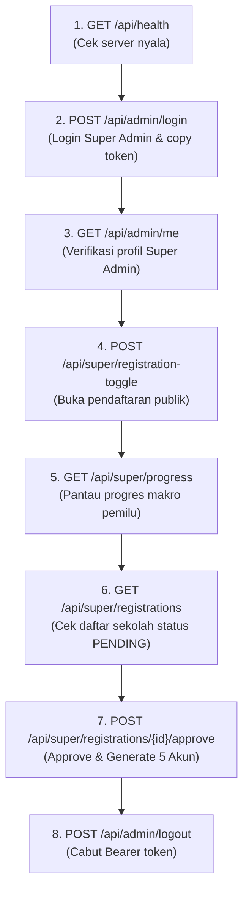

# Dokumentasi Pengujian API (Track 1: Backend Core, Database & Authentication)
**Platform E-Voting Sekolah — KPU Kabupaten Banyumas**

Dokumen ini memuat panduan lengkap pengujian endpoint API Track 1 menggunakan **Thunder Client** (VS Code Extension).

---

## 1. Persiapan Menjalankan Server

1. Buka terminal pada folder `backend`:
   ```powershell
   cd D:\kuliah\ProjectWbsite\e-voting-KPUBanyumas\backend
   ```
2. Pastikan database PostgreSQL / Neon DB sudah dikonfigurasi di file `.env` atau `app/Config/Database.php`.
3. Jalankan migrasi dan seeder awal:
   ```powershell
   php spark migrate
   php spark db:seed DatabaseSeeder
   ```
4. Jalankan development server CodeIgniter 4:
   ```powershell
   php spark serve --port 8080
   ```
   *Base URL aktif: `http://localhost:8080`*

---

## 2. Cara Import Koleksi ke Thunder Client

Kami telah menyediakan file koleksi siap pakai yang dapat langsung di-import:
- **File Koleksi:** `backend/thunder-collection_e-voting-track1.json`

### Langkah Import:
1. Buka tab **Thunder Client** di VS Code.
2. Klik menu **Collections** pada sidebar Thunder Client.
3. Klik ikon menu titik tiga (`...`) di kanan atas panel Collections $\rightarrow$ pilih **Import**.
4. Pilih file [thunder-collection_e-voting-track1.json](file:///D:/kuliah/ProjectWbsite/e-voting-KPUBanyumas/backend/thunder-collection_e-voting-track1.json).
5. Koleksi **"E-Voting KPU Banyumas - Track 1"** akan otomatis muncul lengkap dengan seluruh request.

### Konfigurasi Environment Variable:
Pada tab **Env** Thunder Client, buat atau atur variabel berikut:
- `base_url`: `http://localhost:8080`
- `token`: *(Akan diisi dengan bearer token hasil login Super Admin)*

---

## 3. Rincian Endpoint & Skenario Pengujian

### A. Health Check (Publik)

#### 1. `GET /api/health`
Mengecek status ketersediaan backend API.
- **Method:** `GET`
- **URL:** `{{base_url}}/api/health`
- **Headers:** Tidak memerlukan autentikasi
- **Expected Response (HTTP 200 OK):**
  ```json
  {
    "success": true,
    "message": "API is ready.",
    "data": {
      "status": "ok"
    }
  }
  ```

---

### B. Modul Autentikasi Admin (`/api/admin/*`)

#### 2. `POST /api/admin/login`
Autentikasi akun Super Admin KPU atau Admin Sekolah.
- **Method:** `POST`
- **URL:** `{{base_url}}/api/admin/login`
- **Headers:**
  - `Content-Type: application/json`
- **Request Body (JSON):**
  ```json
  {
    "username": "superadmin",
    "password": "KpuBanyumas2026!"
  }
  ```
- **Expected Response Sukses (HTTP 200 OK):**
  ```json
  {
    "success": true,
    "message": "Login berhasil.",
    "data": {
      "token": "7a8b9c... (string 64 karakter heksadesimal)",
      "expires_at": "2026-11-18 14:30:00",
      "user": {
        "id": "1",
        "name": "Super Admin KPU Banyumas",
        "username": "superadmin",
        "email": "admin@kpu-banyumas.go.id",
        "role": "super_admin",
        "is_primary": "1",
        "election_id": null,
        "created_at": "2026-11-17 14:00:00",
        "updated_at": "2026-11-17 14:00:00"
      }
    }
  }
  ```
  > **TIPS THUNDER CLIENT:** Salin nilai `token` dari respon dan masukkan ke variabel `{{token}}` di Environment Thunder Client atau masukkan ke header `Authorization: Bearer <token>` pada request berikutnya.

- **Expected Response Gagal (HTTP 401 Unauthorized):**
  ```json
  {
    "success": false,
    "message": "Kredensial login tidak valid. Periksa username dan password.",
    "errors": []
  }
  ```

---

#### 3. `GET /api/admin/me`
Melihat profil pengguna yang sedang login berdasarkan Bearer Token.
- **Method:** `GET`
- **URL:** `{{base_url}}/api/admin/me`
- **Headers:**
  - `Authorization: Bearer {{token}}`
- **Expected Response (HTTP 200 OK):**
  ```json
  {
    "success": true,
    "message": "Profil pengguna terautentikasi.",
    "data": {
      "user": {
        "id": "1",
        "name": "Super Admin KPU Banyumas",
        "username": "superadmin",
        "email": "admin@kpu-banyumas.go.id",
        "role": "super_admin",
        "is_primary": "1",
        "election_id": null
      }
    }
  }
  ```
- **Expected Response Jika Token Tidak Disertakan / Kedaluwarsa (HTTP 401):**
  ```json
  {
    "success": false,
    "message": "Bearer token autentikasi tidak ditemukan.",
    "errors": []
  }
  ```

---

#### 4. `POST /api/admin/logout`
Mencabut / membatalkan masa berlaku Bearer Token aktif di database.
- **Method:** `POST`
- **URL:** `{{base_url}}/api/admin/logout`
- **Headers:**
  - `Authorization: Bearer {{token}}`
- **Expected Response (HTTP 200 OK):**
  ```json
  {
    "success": true,
    "message": "Logout berhasil, token akses telah dicabut.",
    "data": []
  }
  ```

---

### C. Modul Super Admin KPU (`/api/super/*`)
> *Seluruh endpoint di bawah ini diproteksi oleh filter `auth` dan filter role `super_admin`.*

#### 5. `POST /api/super/registration-toggle`
Membuka atau menutup formulir pendaftaran sekolah publik (Hanya diperbolehkan saat sistem berstatus `READY`).
- **Method:** `POST`
- **URL:** `{{base_url}}/api/super/registration-toggle`
- **Headers:**
  - `Authorization: Bearer {{token}}`
  - `Content-Type: application/json`
- **Request Body (JSON):**
  ```json
  {
    "is_open": true
  }
  ```
- **Expected Response Sukses (HTTP 200 OK):**
  ```json
  {
    "success": true,
    "message": "Pendaftaran sekolah berhasil dibuka.",
    "data": {
      "election_id": "1",
      "is_registration_open": true,
      "status": "READY"
    }
  }
  ```
- **Expected Response Jika Status Bukan READY (HTTP 422):**
  ```json
  {
    "success": false,
    "message": "Pendaftaran hanya dapat diubah saat sistem berstatus READY. Status saat ini: SETUP.",
    "errors": []
  }
  ```

---

#### 6. `GET /api/super/registrations`
Menampilkan daftar permohonan pendaftaran sekolah yang masuk dengan status `PENDING`.
- **Method:** `GET`
- **URL:** `{{base_url}}/api/super/registrations`
- **Headers:**
  - `Authorization: Bearer {{token}}`
- **Expected Response (HTTP 200 OK):**
  ```json
  {
    "success": true,
    "message": "Daftar permohonan pendaftaran sekolah (PENDING).",
    "data": {
      "total": 1,
      "registrations": [
        {
          "id": "1",
          "status": "PENDING",
          "school_name": "SMA Negeri 1 Purwokerto",
          "npsn": "20301122",
          "contact_name": "Budi Santoso, M.Pd",
          "contact_phone": "081234567890",
          "contact_email": "info@sman1purwokerto.sch.id",
          "created_at": "2026-11-17 14:15:00"
        }
      ]
    }
  }
  ```

---

#### 7. `POST /api/super/registrations/{id}/approve`
Menyetujui pendaftaran sekolah, menaikkan status pemilu dari `PENDING` ke `SETUP`, dan men-generate otomatis **5 akun panitia unik** (1 Utama + 4 Pendukung).
- **Method:** `POST`
- **URL:** `{{base_url}}/api/super/registrations/1/approve` *(Ganti `1` dengan ID election)*
- **Headers:**
  - `Authorization: Bearer {{token}}`
- **Expected Response Sukses (HTTP 201 Created):**
  ```json
  {
    "success": true,
    "message": "Permohonan sekolah disetujui. 5 Akun Panitia Sekolah (1 Utama + 4 Pendukung) berhasil dibuat.",
    "data": {
      "election": {
        "id": "1",
        "status": "SETUP",
        "school_name": "SMA Negeri 1 Purwokerto",
        "npsn": "20301122"
      },
      "accounts": [
        {
          "role": "admin_sekolah",
          "is_primary": true,
          "name": "Admin Utama SMA Negeri 1 Purwokerto",
          "username": "admin_20301122",
          "plain_password": "Kpu!9xQp2#"
        },
        {
          "role": "admin_sekolah",
          "is_primary": false,
          "name": "Admin Pendukung 1 SMA Negeri 1 Purwokerto",
          "username": "support1_20301122",
          "plain_password": "Kpu!mZ4w8@"
        },
        {
          "role": "admin_sekolah",
          "is_primary": false,
          "name": "Admin Pendukung 2 SMA Negeri 1 Purwokerto",
          "username": "support2_20301122",
          "plain_password": "Kpu!7rYt1$"
        },
        {
          "role": "admin_sekolah",
          "is_primary": false,
          "name": "Admin Pendukung 3 SMA Negeri 1 Purwokerto",
          "username": "support3_20301122",
          "plain_password": "Kpu!3vBn9%"
        },
        {
          "role": "admin_sekolah",
          "is_primary": false,
          "name": "Admin Pendukung 4 SMA Negeri 1 Purwokerto",
          "username": "support4_20301122",
          "plain_password": "Kpu!6kLm2^"
        }
      ]
    }
  }
  ```

---

#### 8. `GET /api/super/progress`
Monitoring progres persentase tahapan global pemilu.
*(Keamanan Data: Tidak menampilkan rincian angka suara kandidat atau pemilih).*
- **Method:** `GET`
- **URL:** `{{base_url}}/api/super/progress`
- **Headers:**
  - `Authorization: Bearer {{token}}`
- **Expected Response (HTTP 200 OK):**
  ```json
  {
    "success": true,
    "message": "Status progres global tahapan pemilu.",
    "data": {
      "election_id": "1",
      "status": "SETUP",
      "phase_name": "Persiapan DPT & Paslon",
      "percentage": 30,
      "school_name": "SMA Negeri 1 Purwokerto",
      "is_registration_open": false,
      "dpt_locked": false,
      "candidates_locked": false,
      "report_downloaded": false
    }
  }
  ```

---

#### 9. `POST /api/super/cleanup`
Menghapus seluruh data operasional pemilu dan mereset sistem ke status `READY`.
- **Syarat Wajib:**
  1. Pemilu berstatus `PUBLISHED`
  2. Laporan pemilu telah diunduh oleh panitia sekolah (`report_downloaded_at != null`)
  3. Konfirmasi teks persis `HAPUS DATA`
- **Method:** `POST`
- **URL:** `{{base_url}}/api/super/cleanup`
- **Headers:**
  - `Authorization: Bearer {{token}}`
  - `Content-Type: application/json`
- **Request Body (JSON):**
  ```json
  {
    "confirmation_code": "HAPUS DATA"
  }
  ```
- **Expected Response Sukses (HTTP 200 OK):**
  ```json
  {
    "success": true,
    "message": "Seluruh data operasional pemilu berhasil dibersihkan. Sistem telah direset ke status READY.",
    "data": {
      "election_id": "1",
      "status": "READY"
    }
  }
  ```
- **Expected Response Jika Konfirmasi Salah (HTTP 422):**
  ```json
  {
    "success": false,
    "message": "Konfirmasi tidak valid. Anda wajib mengetik \"HAPUS DATA\" dengan persis.",
    "errors": []
  }
  ```
- **Expected Response Jika Laporan Belum Diunduh (HTTP 422):**
  ```json
  {
    "success": false,
    "message": "Laporan resmi pemilu belum diunduh oleh panitia sekolah. Cleanup ditolak.",
    "errors": []
  }
  ```

---

## 4. Alur Skenario Uji Rekomendasi (End-to-End Test Flow)

Urutan uji coba yang disarankan di Thunder Client:


