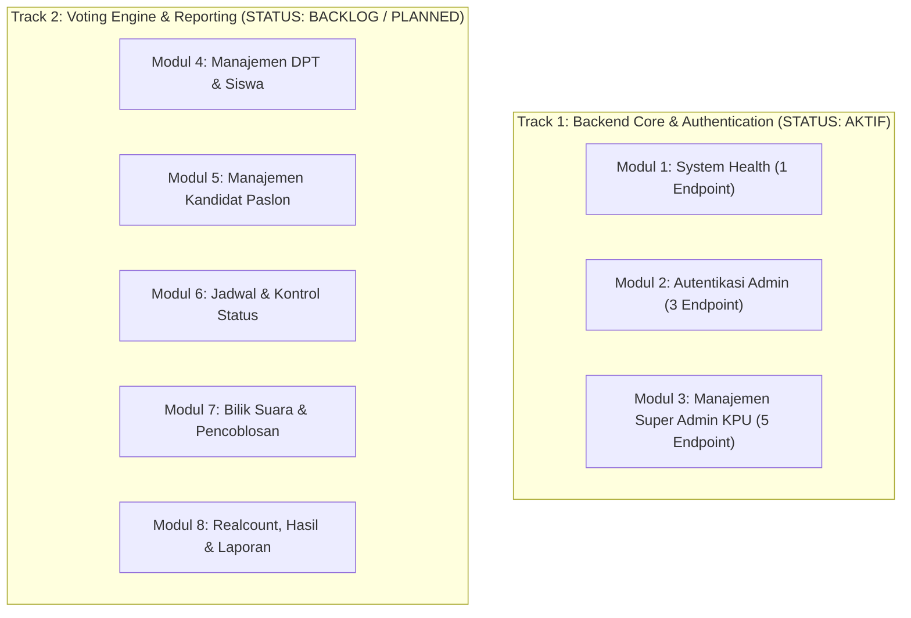

# Dokumentasi Backend API Endpoints
**Platform E-Voting Sekolah — KPU Kabupaten Banyumas**
*Single-Tenant Sequential Architecture*

---

Dokumen ini disusun oleh **Backend API Documentation Engineer** sebagai hasil analisis mendalam terhadap source code backend, konfigurasi routing, controller, service layer, filter/middleware, model database, dan migration pada project **Platform E-Voting Sekolah (KPU Kabupaten Banyumas)**.

---

## 1. Informasi API

| Informasi | Detail Konfigurasi Aktual |
| :--- | :--- |
| **Nama Project** | Platform E-Voting Sekolah (KPU Kabupaten Banyumas) |
| **Fokus Rilis Saat Ini** | **Track 1:** Backend Core, Database, Autentikasi & Super Admin KPU |
| **Framework Backend** | **CodeIgniter 4** (`codeigniter4/framework: ^4.7`) |
| **Runtime & Bahasa** | **PHP ^8.2** dengan penegakan tipe ketat (`declare(strict_types=1);`) |
| **Database Server** | **PostgreSQL** (Koneksi `Postgre` via Neon Cloud / Local DB) |
| **Nama Database** | `e_voting_kpu` (Konfigurasi `.env`: `database.default.database`) |
| **Base URL Terkonfigurasi** | • `.env`: `http://localhost:8000/`<br>• Development Server / Thunder Client / Postman: `http://localhost:8080/` |
| **Format Request Body** | `application/json` (direkomendasikan) atau `application/x-www-form-urlencoded` |
| **Format Response** | **Standardized JSON** via `App\Services\ApiResponse` |
| **Metode Autentikasi** | **Custom Cryptographic Bearer Token** (64 karakter heksadesimal acak) |
| **Penyimpanan Token** | Disimpan dalam bentuk **Hash SHA-256** pada tabel `personal_access_tokens` |
| **Masa Berlaku Token** | **24 Jam** (86.400 detik) sejak diterbitkan |
| **Mekanisme Revokasi** | Dihapus dari tabel database saat logout atau kedaluwarsa otomatis |

### Standarisasi Format Response JSON

Seluruh API CodeIgniter 4 pada proyek ini menggunakan format respon terpusat yang seragam:

#### Respon Sukses (HTTP 200 / 201)
```json
{
  "success": true,
  "message": "Deskripsi pesan sukses yang informatif",
  "data": {}
}
```

#### Respon Gagal / Error (HTTP 400 / 401 / 403 / 404 / 422 / 500)
```json
{
  "success": false,
  "message": "Deskripsi pesan error manusiawi",
  "errors": {}
}
```

---

## 2. Daftar Endpoint

Berikut adalah daftar matriks seluruh endpoint API yang terdaftar di file routing `app/Config/Routes.php` dan implementasi Controller yang bersesuaian.

> [!NOTE]
> Sistem mengaktifkan konfigurasi ketat `Routing::$autoRoute = false` pada `app/Config/Routing.php`. Hanya rute yang terdaftar secara eksplisit di `app/Config/Routes.php` yang dapat diakses oleh client.

### Tabel Matriks Endpoint API (Aktif & Terimplementasi)

| No | Method | Endpoint | Fungsi | Authentication | Role / Permission | Controller & Method | Status |
| :---: | :---: | :--- | :--- | :---: | :---: | :--- | :---: |
| 1 | `GET` | `/api/health` | Cek ketersediaan & kesiapan backend API | Tidak (Publik) | Publik / Siapa saja | `App\Controllers\Api\HealthController::index` | **Aktif** |
| 2 | `POST` | `/api/admin/login` | Login admin & penerbitan Bearer Token 64-karakter | Tidak (Publik) | Kredensial Admin Valid | `App\Controllers\Api\AuthController::login` | **Aktif** |
| 3 | `POST` | `/api/admin/logout` | Revokasi & penghapusan token aktif | Ya (`auth`) | Semua role terautentikasi | `App\Controllers\Api\AuthController::logout` | **Aktif** |
| 4 | `GET` | `/api/admin/me` | Mengambil profil user yang sedang login | Ya (`auth`) | Semua role terautentikasi | `App\Controllers\Api\AuthController::me` | **Aktif** |
| 5 | `POST` | `/api/super/registration-toggle` | Buka/tutup form registrasi publik (Hanya status READY) | Ya (`auth`) | `super_admin` | `App\Controllers\Api\SuperAdminController::toggleRegistration` | **Aktif** |
| 6 | `GET` | `/api/super/registrations` | Menampilkan daftar permohonan sekolah (status PENDING) | Ya (`auth`) | `super_admin` | `App\Controllers\Api\SuperAdminController::registrations` | **Aktif** |
| 7 | `POST` | `/api/super/registrations/{id}/approve` | Setujui sekolah, transisi ke SETUP, & generate 5 akun panitia | Ya (`auth`) | `super_admin` | `App\Controllers\Api\SuperAdminController::approveRegistration` | **Aktif** |
| 8 | `GET` | `/api/super/progress` | Monitoring progres persentase tahapan global pemilu | Ya (`auth`) | `super_admin` | `App\Controllers\Api\SuperAdminController::progress` | **Aktif** |
| 9 | `POST` | `/api/super/cleanup` | Hapus seluruh data operasional & reset ke status READY | Ya (`auth`) | `super_admin` | `App\Controllers\Api\SuperAdminController::cleanup` | **Aktif** |

### Endpoint Web Default (Non-API)

| No | Method | Endpoint | Fungsi | Authentication | Role | Controller & Method | Status |
| :---: | :---: | :--- | :--- | :---: | :---: | :--- | :---: |
| * | `GET` | `/` | Halaman HTML pembuka default CodeIgniter | Tidak | Publik | `App\Controllers\Home::index` | **Aktif** |

---

## 3. Detail Setiap Endpoint

---

### 3.1. Health Check (Publik)

#### `GET /api/health`

- **HTTP Method:** `GET`
- **URL Endpoint:** `/api/health`
- **Deskripsi Fungsi:** Memeriksa status kesehatan, uptime, dan kesiapan sistem backend API CodeIgniter 4 tanpa memerlukan autentikasi. Digunakan untuk health monitoring, load balancer probe, dan uji konektivitas awal aplikasi.
- **Parameter URL:** Tidak ditemukan (Tidak ada path variable maupun query parameters).
- **Request Body:** Tidak ditemukan (Kosong).
- **Headers:**
  - `Accept: application/json`
- **Authentication:** Tidak (Terbuka untuk umum).
- **Role/Permission:** Publik / Siapa saja.
- **Proses yang Dilakukan:**
  1. Menerima request HTTP `GET`.
  2. Memanggil static method `App\Services\ApiResponse::success()`.
  3. Mengembalikan payload status OK dengan HTTP status 200.
- **Response Sukses (HTTP 200 OK):**
  ```json
  {
    "success": true,
    "message": "API is ready.",
    "data": {
      "status": "ok"
    }
  }
  ```
- **Response Error:** Tidak ditemukan skenario error terprogram (Akan menghasilkan HTTP 500 bawaan framework jika terjadi kegagalan fatal pada server PHP).
- **Controller & Method yang Menangani:** `App\Controllers\Api\HealthController::index`

---

### 3.2. Modul Autentikasi & Sesi Admin

#### `POST /api/admin/login`

- **HTTP Method:** `POST`
- **URL Endpoint:** `/api/admin/login`
- **Deskripsi Fungsi:** Mengotentikasi kredensial pengguna administratif (`super_admin` KPU maupun `admin_sekolah`), memverifikasi password terenkripsi bcrypt, menerbitkan Bearer Token aman sepanjang 64 karakter heksadesimal, menyimpan hash SHA-256 token di basis data, dan mencatat riwayat login ke tabel audit log.
- **Parameter URL:** Tidak ditemukan.
- **Request Body:**
  - **Content-Type:** `application/json` atau `application/x-www-form-urlencoded`
  - **Schema Validasi (`App\Requests\LoginRequest`):**
    - `username` *(string, required, min_length[3], max_length[100])*: Username akun atau alamat email terdaftar.
    - `password` *(string, required, min_length[6])*: Kata sandi akun.
  - **Contoh Request Body (JSON):**
    ```json
    {
      "username": "superadmin",
      "password": "KpuBanyumas2026!"
    }
    ```
- **Headers:**
  - `Content-Type: application/json`
  - `Accept: application/json`
- **Authentication:** Tidak (Endpoint publik untuk mendapatkan token).
- **Role/Permission:** Terbuka bagi pengguna yang memiliki akun di tabel `users`.
- **Proses yang Dilakukan:**
  1. Memvalidasi payload request melalui `LoginRequest`.
  2. Jika validasi gagal, melempar `ValidationException` yang ditangkap Controller untuk mengembalikan HTTP 422.
  3. Mengambil alamat IP client melalui `$this->request->getIPAddress()`.
  4. Memanggil `AuthService::login($username, $password, $ip)`.
  5. Mencari data akun di database melalui `UserModel::findByUsernameOrEmail($identifier)`.
  6. Memverifikasi hash kata sandi menggunakan `password_verify($password, $user['password_hash'])`.
  7. Jika user tidak ditemukan atau password tidak cocok, melempar `RuntimeException` (HTTP 401).
  8. Membangkitkan token acak 64 karakter heksadesimal menggunakan `bin2hex(random_bytes(32))`.
  9. Menghitung nilai hash token menggunakan `hash('sha256', $plainToken)`.
  10. Menetapkan masa kedaluwarsa 24 jam ke depan (`date('Y-m-d H:i:s', time() + 86400)`).
  11. Menyimpan hash token, `user_id`, `expires_at`, dan `last_used_at` ke tabel `personal_access_tokens`.
  12. Mencatat entri audit log ke tabel `audit_logs` dengan format aksi: `USER_LOGIN: <username> (<role>)` (tanpa mencatat password).
  13. Menghapus key `password_hash` dari payload respon demi keamanan informasi.
  14. Mengembalikan HTTP 200 dengan token plain text, waktu kedaluwarsa, dan objek user.
- **Response Sukses (HTTP 200 OK):**
  ```json
  {
    "success": true,
    "message": "Login berhasil.",
    "data": {
      "token": "7a8b9c1d2e3f4a5b6c7d8e9f0a1b2c3d4e5f6a7b8c9d0e1f2a3b4c5d6e7f8a9b",
      "expires_at": "2026-11-19 14:30:00",
      "user": {
        "id": "1",
        "name": "Super Admin KPU Banyumas",
        "username": "superadmin",
        "email": "admin@kpu-banyumas.go.id",
        "role": "super_admin",
        "is_primary": "1",
        "election_id": null,
        "created_at": "2026-11-17 14:00:00",
        "updated_at": "2026-11-17 14:00:00"
      }
    }
  }
  ```
- **Response Error:**
  - **HTTP 422 Unprocessable Entity (Validasi input gagal):**
    ```json
    {
      "success": false,
      "message": "Validasi input gagal.",
      "errors": {
        "username": [
          "Username atau email wajib diisi."
        ],
        "password": [
          "Password minimal terdiri dari 6 karakter."
        ]
      }
    }
    ```
  - **HTTP 401 Unauthorized (Kredensial salah / tidak cocok):**
    ```json
    {
      "success": false,
      "message": "Kredensial login tidak valid. Periksa username dan password.",
      "errors": []
    }
    ```
  - **HTTP 500 Internal Server Error (Kesalahan server tidak terduga):**
    ```json
    {
      "success": false,
      "message": "Terjadi kesalahan internal server saat autentikasi.",
      "errors": []
    }
    ```
- **Controller & Method yang Menangani:** `App\Controllers\Api\AuthController::login`

---

#### `POST /api/admin/logout`

- **HTTP Method:** `POST`
- **URL Endpoint:** `/api/admin/logout`
- **Deskripsi Fungsi:** Mencabut (*revoke*) Bearer Token akses yang sedang aktif dengan menghapus rekaman token terkait dari tabel `personal_access_tokens` dan mencatat riwayat logout ke `audit_logs`.
- **Parameter URL:** Tidak ditemukan.
- **Request Body:** Tidak ditemukan (Kosong).
- **Headers:**
  - `Authorization: Bearer <token>` *(Wajib)*
  - `Accept: application/json`
- **Authentication:** Ya (Diproteksi oleh filter `auth` / `App\Filters\AuthFilter`).
- **Role/Permission:** Pengguna terautentikasi (berlaku untuk role `super_admin` maupun `admin_sekolah`).
- **Proses yang Dilakukan:**
  1. Filter `auth` memvalidasi keberadaan header `Authorization: Bearer <token>`.
  2. Token di-hash dengan SHA-256 dan dicocokkan ke tabel `personal_access_tokens` dengan syarat `expires_at > NOW()`.
  3. Jika valid, data pengguna disimpan ke memory thread `AuthContext`.
  4. Controller membaca token dan identitas user dari `AuthContext`.
  5. Memanggil `AuthService::logout($token, $userId, $ip)`.
  6. Menghapus baris token dari tabel `personal_access_tokens` berdasarkan `token_hash`.
  7. Mencatat log `USER_LOGOUT` ke tabel `audit_logs`.
  8. Mengembalikan respon sukses HTTP 200.
  9. Filter `auth` memicu `after()` untuk membersihkan `AuthContext::clear()`.
- **Response Sukses (HTTP 200 OK):**
  ```json
  {
    "success": true,
    "message": "Logout berhasil, token akses telah dicabut.",
    "data": []
  }
  ```
- **Response Error:**
  - **HTTP 401 Unauthorized (Token tidak disertakan):**
    ```json
    {
      "success": false,
      "message": "Bearer token autentikasi tidak ditemukan.",
      "errors": []
    }
    ```
  - **HTTP 401 Unauthorized (Token tidak valid atau kedaluwarsa):**
    ```json
    {
      "success": false,
      "message": "Sesi login telah kedaluwarsa atau token tidak valid.",
      "errors": []
    }
    ```
  - **HTTP 401 Unauthorized (Placeholder variabel Thunder Client/Postman belum diisi):**
    ```json
    {
      "success": false,
      "message": "Nilai token belum diisi. Pastikan Anda telah mengeksekusi \"Login Super Admin\", lalu ganti {{token}} dengan string token dari respon login.",
      "errors": []
    }
    ```
  - **HTTP 500 Internal Server Error:**
    ```json
    {
      "success": false,
      "message": "Gagal memproses logout.",
      "errors": []
    }
    ```
- **Controller & Method yang Menangani:** `App\Controllers\Api\AuthController::logout`

---

#### `GET /api/admin/me`

- **HTTP Method:** `GET`
- **URL Endpoint:** `/api/admin/me`
- **Deskripsi Fungsi:** Mengambil informasi profil lengkap akun pengguna yang sedang aktif terautentikasi berdasarkan Bearer Token yang disertakan pada header request.
- **Parameter URL:** Tidak ditemukan.
- **Request Body:** Tidak ditemukan (Kosong).
- **Headers:**
  - `Authorization: Bearer <token>` *(Wajib)*
  - `Accept: application/json`
- **Authentication:** Ya (Diproteksi oleh filter `auth` / `App\Filters\AuthFilter`).
- **Role/Permission:** Semua pengguna terautentikasi (`super_admin` maupun `admin_sekolah`).
- **Proses yang Dilakukan:**
  1. Filter `auth` memvalidasi token dan memperbarui timestamp `last_used_at` pada tabel `personal_access_tokens`.
  2. Filter menyimpan objek user ke `AuthContext`.
  3. Controller memanggil `AuthContext::getUser()`.
  4. Jika user tidak ditemukan, mengembalikan HTTP 401.
  5. Mengembalikan data profil user (field sensitif `password_hash` sudah dihapus secara otomatis).
- **Response Sukses (HTTP 200 OK):**
  ```json
  {
    "success": true,
    "message": "Profil pengguna terautentikasi.",
    "data": {
      "user": {
        "id": "1",
        "name": "Super Admin KPU Banyumas",
        "username": "superadmin",
        "email": "admin@kpu-banyumas.go.id",
        "role": "super_admin",
        "is_primary": "1",
        "election_id": null,
        "created_at": "2026-11-17 14:00:00",
        "updated_at": "2026-11-17 14:00:00"
      }
    }
  }
  ```
- **Response Error:**
  - **HTTP 401 Unauthorized:**
    ```json
    {
      "success": false,
      "message": "Bearer token autentikasi tidak ditemukan.",
      "errors": []
    }
    ```
- **Controller & Method yang Menangani:** `App\Controllers\Api\AuthController::me`

---

### 3.3. Modul Super Admin KPU

> [!IMPORTANT]
> Seluruh endpoint di bawah grup `/api/super/*` dilindungi oleh kombinasi filter: `filter => ['auth', 'role:super_admin']`.
> Percobaan akses oleh role selain `super_admin` (misalnya `admin_sekolah`) akan langsung ditolak dengan respon **HTTP 403 Forbidden**.

#### `POST /api/super/registration-toggle`

- **HTTP Method:** `POST`
- **URL Endpoint:** `/api/super/registration-toggle`
- **Deskripsi Fungsi:** Membuka atau menutup formulir pendaftaran sekolah publik secara terpusat oleh Super Admin KPU. Aturan integritas FSM: Perubahan sakelar pendaftaran hanya diperbolehkan saat sistem pemilu berada pada status `READY`.
- **Parameter URL:** Tidak ditemukan.
- **Request Body:**
  - **Content-Type:** `application/json` atau `application/x-www-form-urlencoded`
  - **Schema Validasi (`App\Requests\RegistrationToggleRequest`):**
    - `is_open` *(boolean / mixed, required)*: Status pembukaan pendaftaran (`true` untuk membuka, `false` untuk menutup).
  - **Contoh Request Body (JSON):**
    ```json
    {
      "is_open": true
    }
    ```
- **Headers:**
  - `Authorization: Bearer <token>` *(Wajib)*
  - `Content-Type: application/json`
  - `Accept: application/json`
- **Authentication:** Ya (Filter `auth`).
- **Role/Permission:** Khusus role `super_admin` (Filter `role:super_admin`).
- **Proses yang Dilakukan:**
  1. Memverifikasi Bearer Token dan memastikan role adalah `super_admin`.
  2. Memvalidasi keberadaan field `is_open` melalui `RegistrationToggleRequest`.
  3. Melakukan casting nilai ke boolean via `filter_var(..., FILTER_VALIDATE_BOOLEAN)`.
  4. Mengambil sesi pemilu aktif melalui `ElectionModel::getActiveSession()`.
  5. Memvalidasi bahwa kolom `status` bernilai tepat `READY`. Jika bukan `READY`, melempar `RuntimeException` (HTTP 422).
  6. Memperbarui kolom `is_registration_open` di tabel `elections`.
  7. Mencatat ke `audit_logs`: `SUPER_ADMIN_TOGGLE_REGISTRATION: DIBUKA` atau `DITUTUP`.
  8. Mengembalikan data sesi pemilu terupdate dengan status HTTP 200.
- **Response Sukses (HTTP 200 OK):**
  ```json
  {
    "success": true,
    "message": "Pendaftaran sekolah berhasil dibuka.",
    "data": {
      "election_id": "1",
      "is_registration_open": true,
      "status": "READY"
    }
  }
  ```
- **Response Error:**
  - **HTTP 401 Unauthorized (Token hilang / tidak valid):**
    ```json
    {
      "success": false,
      "message": "Bearer token autentikasi tidak ditemukan.",
      "errors": []
    }
    ```
  - **HTTP 403 Forbidden (Bukan Super Admin):**
    ```json
    {
      "success": false,
      "message": "Akses ditolak: role \"admin_sekolah\" tidak memiliki izin untuk rute ini.",
      "errors": []
    }
    ```
  - **HTTP 422 Unprocessable Entity (Validasi input gagal):**
    ```json
    {
      "success": false,
      "message": "Validasi input gagal.",
      "errors": {
        "is_open": [
          "Status pembukaan pendaftaran (is_open) wajib diisi."
        ]
      }
    }
    ```
  - **HTTP 422 Unprocessable Entity (Status bukan READY):**
    ```json
    {
      "success": false,
      "message": "Pendaftaran hanya dapat diubah saat sistem berstatus READY. Status saat ini: SETUP.",
      "errors": []
    }
    ```
  - **HTTP 500 Internal Server Error:**
    ```json
    {
      "success": false,
      "message": "Terjadi kesalahan server saat memperbarui toggle pendaftaran.",
      "errors": []
    }
    ```
- **Controller & Method yang Menangani:** `App\Controllers\Api\SuperAdminController::toggleRegistration`

---

#### `GET /api/super/registrations`

- **HTTP Method:** `GET`
- **URL Endpoint:** `/api/super/registrations`
- **Deskripsi Fungsi:** Mengambil daftar seluruh permohonan pendaftaran sekolah yang masuk dan saat ini sedang menunggu persetujuan (berstatus `PENDING`).
- **Parameter URL:** Tidak ditemukan.
- **Request Body:** Tidak ditemukan (Kosong).
- **Headers:**
  - `Authorization: Bearer <token>` *(Wajib)*
  - `Accept: application/json`
- **Authentication:** Ya (Filter `auth`).
- **Role/Permission:** Khusus role `super_admin` (Filter `role:super_admin`).
- **Proses yang Dilakukan:**
  1. Memverifikasi Bearer Token dan otorisasi role `super_admin`.
  2. Menjalankan query ke database melalui `ElectionModel` dengan klausa `where('status', 'PENDING')`.
  3. Mengembalikan array berisi seluruh permohonan pendaftaran beserta jumlah totalnya (`total`).
- **Response Sukses (HTTP 200 OK):**
  ```json
  {
    "success": true,
    "message": "Daftar permohonan pendaftaran sekolah (PENDING).",
    "data": {
      "total": 1,
      "registrations": [
        {
          "id": "1",
          "status": "PENDING",
          "is_registration_open": "0",
          "school_name": "SMA Negeri 1 Purwokerto",
          "npsn": "20301122",
          "contact_name": "Budi Santoso, M.Pd",
          "contact_phone": "081234567890",
          "contact_email": "info@sman1purwokerto.sch.id",
          "start_time": null,
          "end_time": null,
          "dpt_locked_at": null,
          "candidates_locked_at": null,
          "report_downloaded_at": null,
          "created_at": "2026-11-17 14:15:00",
          "updated_at": "2026-11-17 14:15:00"
        }
      ]
    }
  }
  ```
- **Response Error:**
  - **HTTP 401 Unauthorized**
  - **HTTP 403 Forbidden**
  - **HTTP 500 Internal Server Error:**
    ```json
    {
      "success": false,
      "message": "Gagal mengambil daftar permohonan sekolah.",
      "errors": []
    }
    ```
- **Controller & Method yang Menangani:** `App\Controllers\Api\SuperAdminController::registrations`

---

#### `POST /api/super/registrations/{id}/approve`

- **HTTP Method:** `POST`
- **URL Endpoint:** `/api/super/registrations/{id}/approve`
- **Deskripsi Fungsi:** Menyetujui permohonan registrasi sekolah tertentu berdasarkan ID pemilu, menaikkan status pemilu dari `PENDING` ke `SETUP`, serta men-generate secara otomatis **5 akun panitia sekolah** (1 Admin Utama dengan `is_primary = true` dan 4 Admin Pendukung dengan `is_primary = false`). Kredensial plain text dikembalikan dalam respon untuk disalin dan didistribusikan secara manual oleh KPU via WhatsApp/Email.
- **Parameter URL:**
  - `id` *(integer, required, path parameter)*: ID unik sesi pemilu pada tabel `elections`. Contoh: `/api/super/registrations/1/approve`.
- **Request Body:** Tidak ditemukan (Kosong).
- **Headers:**
  - `Authorization: Bearer <token>` *(Wajib)*
  - `Accept: application/json`
- **Authentication:** Ya (Filter `auth`).
- **Role/Permission:** Khusus role `super_admin` (Filter `role:super_admin`).
- **Proses yang Dilakukan:**
  1. Memvalidasi parameter path `$id` sebagai bilangan bulat positif (`$electionId > 0`).
  2. Mencari sesi pemilu di tabel `elections` dan memastikan kolom `status` bernilai `PENDING`. Jika tidak cocok, melempar `RuntimeException` (HTTP 422).
  3. Membuka transaksi database ketat (`$db->transBegin()`).
  4. Membersihkan string NPSN (`preg_replace('/[^a-zA-Z0-9]/', '', $npsn)`) sebagai suffix username unik.
  5. **Pembuatan Akun Admin Utama (1 Akun):**
     - Username: `admin_<npsn>` (misal: `admin_20301122`).
     - Password plain text di-generate secara acak 10 karakter alfanumerik + simbol (`generateSecurePassword()`).
     - Di-insert ke tabel `users` dengan `role = 'admin_sekolah'`, `is_primary = true`, `email = contact_email`, dan `election_id = $electionId`.
  6. **Pembuatan Akun Admin Pendukung (4 Akun):**
     - Username berurutan: `support1_<npsn>` hingga `support4_<npsn>`.
     - Password plain text di-generate secara unik dan acak 10 karakter.
     - Di-insert ke tabel `users` dengan `role = 'admin_sekolah'`, `is_primary = false`, `email = null`, dan `election_id = $electionId`.
  7. Memperbarui status sesi pemilu dari `PENDING` menjadi `SETUP`.
  8. Mencatat audit log: `SUPER_ADMIN_APPROVE_REGISTRATION: ID <id> (<school_name>)`.
  9. Melakukan commit transaksi (`$db->transCommit()`). Jika terjadi kegagalan di langkah mana pun, transaksi dibatalkan (`$db->transRollback()`).
  10. Mengembalikan status HTTP 201 Created berisi informasi sekolah dan daftar 5 akun lengkap dengan `plain_password`.
- **Response Sukses (HTTP 201 Created):**
  ```json
  {
    "success": true,
    "message": "Permohonan sekolah disetujui. 5 Akun Panitia Sekolah (1 Utama + 4 Pendukung) berhasil dibuat.",
    "data": {
      "election": {
        "id": "1",
        "status": "SETUP",
        "school_name": "SMA Negeri 1 Purwokerto",
        "npsn": "20301122"
      },
      "accounts": [
        {
          "role": "admin_sekolah",
          "is_primary": true,
          "name": "Admin Utama SMA Negeri 1 Purwokerto",
          "username": "admin_20301122",
          "plain_password": "Kpu!9xQp2#"
        },
        {
          "role": "admin_sekolah",
          "is_primary": false,
          "name": "Admin Pendukung 1 SMA Negeri 1 Purwokerto",
          "username": "support1_20301122",
          "plain_password": "Kpu!mZ4w8@"
        },
        {
          "role": "admin_sekolah",
          "is_primary": false,
          "name": "Admin Pendukung 2 SMA Negeri 1 Purwokerto",
          "username": "support2_20301122",
          "plain_password": "Kpu!7rYt1$"
        },
        {
          "role": "admin_sekolah",
          "is_primary": false,
          "name": "Admin Pendukung 3 SMA Negeri 1 Purwokerto",
          "username": "support3_20301122",
          "plain_password": "Kpu!3vBn9%"
        },
        {
          "role": "admin_sekolah",
          "is_primary": false,
          "name": "Admin Pendukung 4 SMA Negeri 1 Purwokerto",
          "username": "support4_20301122",
          "plain_password": "Kpu!6kLm2^"
        }
      ]
    }
  }
  ```
- **Response Error:**
  - **HTTP 400 Bad Request (ID parameter tidak valid):**
    ```json
    {
      "success": false,
      "message": "ID permohonan tidak valid.",
      "errors": []
    }
    ```
  - **HTTP 401 Unauthorized**
  - **HTTP 403 Forbidden**
  - **HTTP 422 Unprocessable Entity (Status bukan PENDING atau data tidak ada):**
    ```json
    {
      "success": false,
      "message": "Permohonan sekolah tidak ditemukan atau status bukan PENDING.",
      "errors": []
    }
    ```
  - **HTTP 500 Internal Server Error (Database rollback failure):**
    ```json
    {
      "success": false,
      "message": "Gagal menyetujui permohonan sekolah: [rincian error]",
      "errors": []
    }
    ```
- **Controller & Method yang Menangani:** `App\Controllers\Api\SuperAdminController::approveRegistration`

---

#### `GET /api/super/progress`

- **HTTP Method:** `GET`
- **URL Endpoint:** `/api/super/progress`
- **Deskripsi Fungsi:** Mengambil status kemajuan dan persentase tahapan makro pemilu untuk kebutuhan monitoring dan evaluasi (Monev) Super Admin KPU.
  > [!NOTE]
  > **Keamanan & Kerahasiaan Data:** Endpoint ini secara sengaja **tidak mengekspos** rincian perolehan suara kandidat, data DPT, maupun surat suara bilik, demi mematuhi prinsip pemisahan wewenang (*Separation of Concerns*).
- **Parameter URL:** Tidak ditemukan.
- **Request Body:** Tidak ditemukan (Kosong).
- **Headers:**
  - `Authorization: Bearer <token>` *(Wajib)*
  - `Accept: application/json`
- **Authentication:** Ya (Filter `auth`).
- **Role/Permission:** Khusus role `super_admin` (Filter `role:super_admin`).
- **Proses yang Dilakukan:**
  1. Memverifikasi Bearer Token dan role `super_admin`.
  2. Membaca sesi pemilu aktif melalui `ElectionModel::getActiveSession()`.
  3. Jika belum ada sesi pemilu, mengembalikan persentase 0% dengan status `READY`.
  4. Menghitung persentase tahapan berdasarkan mapping status FSM resmi:
     - `READY`: 0% (*"Sistem Kosong & Siap"*)
     - `PENDING`: 15% (*"Pendaftaran Sekolah Masuk"*)
     - `SETUP`: 30% (*"Persiapan DPT & Paslon"*)
     - `ACTIVE`: 60% (*"Pemungutan Suara Berlangsung"*)
     - `CLOSED`: 80% (*"Pemungutan Suara Selesai"*)
     - `FINALIZED`: 90% (*"Hasil Pemilihan Dikunci"*)
     - `PUBLISHED`: 100% (*"Hasil Resmi Dipublikasikan"*)
     - `CLEANUP`: 0% (*"Proses Pembersihan Data"*)
  5. Memeriksa status flag penguncian (`dpt_locked_at`, `candidates_locked_at`, `report_downloaded_at`).
  6. Mengembalikan objek status tahapan pemilu ke client.
- **Response Sukses (HTTP 200 OK):**
  ```json
  {
    "success": true,
    "message": "Status progres global tahapan pemilu.",
    "data": {
      "election_id": "1",
      "status": "SETUP",
      "phase_name": "Persiapan DPT & Paslon",
      "percentage": 30,
      "school_name": "SMA Negeri 1 Purwokerto",
      "is_registration_open": false,
      "dpt_locked": false,
      "candidates_locked": false,
      "report_downloaded": false
    }
  }
  ```
- **Response Error:**
  - **HTTP 401 Unauthorized**
  - **HTTP 403 Forbidden**
  - **HTTP 500 Internal Server Error:**
    ```json
    {
      "success": false,
      "message": "Gagal mengambil progres tahapan pemilu.",
      "errors": []
    }
    ```
- **Controller & Method yang Menangani:** `App\Controllers\Api\SuperAdminController::progress`

---

#### `POST /api/super/cleanup`

- **HTTP Method:** `POST`
- **URL Endpoint:** `/api/super/cleanup`
- **Deskripsi Fungsi:** Menghapus secara permanen seluruh data operasional sesi pemilu yang telah selesai dan mereset status aplikasi kembali ke `READY` agar siap digunakan oleh sekolah berikutnya (*single-tenant sequential lifecycle*).
  > [!CAUTION]
  > **3 Syarat Wajib & Pengaman Berlapis Sebelum Cleanup:**
  > 1. Sesi pemilu wajib berada pada status `PUBLISHED`.
  > 2. Laporan resmi pemilu wajib sudah diunduh oleh panitia sekolah (`report_downloaded_at IS NOT NULL`).
  > 3. Super Admin wajib mengirimkan string konfirmasi teks persis `"HAPUS DATA"`.
- **Parameter URL:** Tidak ditemukan.
- **Request Body:**
  - **Content-Type:** `application/json` atau `application/x-www-form-urlencoded`
  - **Schema Validasi (`App\Requests\CleanupRequest`):**
    - `confirmation_code` *(string, required)*: Kode teks konfirmasi penghapusan. Wajib bernilai tepat `"HAPUS DATA"`.
  - **Contoh Request Body (JSON):**
    ```json
    {
      "confirmation_code": "HAPUS DATA"
    }
    ```
- **Headers:**
  - `Authorization: Bearer <token>` *(Wajib)*
  - `Content-Type: application/json`
  - `Accept: application/json`
- **Authentication:** Ya (Filter `auth`).
- **Role/Permission:** Khusus role `super_admin` (Filter `role:super_admin`).
- **Proses yang Dilakukan:**
  1. Memvalidasi payload request melalui `CleanupRequest`.
  2. Mengambil sesi pemilu aktif dari basis data.
  3. Memeriksa syarat status: Jika `status !== 'PUBLISHED'`, melempar `RuntimeException` (HTTP 422).
  4. Memeriksa syarat laporan: Jika `report_downloaded_at` masih kosong, melempar `RuntimeException` (HTTP 422).
  5. Memeriksa kode konfirmasi: Jika `trim($confirmationCode) !== 'HAPUS DATA'`, melempar `RuntimeException` (HTTP 422).
  6. Membuka transaksi database (`$db->transBegin()`).
  7. Mengosongkan tabel `ballots` via `BallotModel::emptyTable()`.
  8. Mengosongkan tabel `voting_tokens` via `VotingTokenModel::emptyTable()`.
  9. Mengosongkan tabel `voters` via `VoterModel::emptyTable()`.
  10. Mengosongkan tabel `candidates` via `CandidateModel::emptyTable()`.
  11. Menghapus seluruh akun panitia sekolah di tabel `users` (`where('role', 'admin_sekolah')->delete()`). Akun `super_admin` tetap aman dan dipertahankan.
  12. Mereset baris sesi di tabel `elections` menjadi status `READY`, `is_registration_open = false`, dan menghapus seluruh metadata sekolah sebelumnya.
  13. Mencatat aksi cleanup ke `audit_logs`.
  14. Melakukan commit transaksi (`$db->transCommit()`).
  15. Mengembalikan HTTP 200 dengan status `READY`.
- **Response Sukses (HTTP 200 OK):**
  ```json
  {
    "success": true,
    "message": "Seluruh data operasional pemilu berhasil dibersihkan. Sistem telah direset ke status READY.",
    "data": {
      "election_id": "1",
      "status": "READY"
    }
  }
  ```
- **Response Error:**
  - **HTTP 401 Unauthorized**
  - **HTTP 403 Forbidden**
  - **HTTP 422 Unprocessable Entity (Validasi input gagal):**
    ```json
    {
      "success": false,
      "message": "Validasi input gagal.",
      "errors": {
        "confirmation_code": [
          "Kode konfirmasi teks wajib diisi."
        ]
      }
    }
    ```
  - **HTTP 422 Unprocessable Entity (Kode konfirmasi tidak cocok):**
    ```json
    {
      "success": false,
      "message": "Konfirmasi tidak valid. Anda wajib mengetik \"HAPUS DATA\" dengan persis.",
      "errors": []
    }
    ```
  - **HTTP 422 Unprocessable Entity (Laporan belum diunduh):**
    ```json
    {
      "success": false,
      "message": "Laporan resmi pemilu belum diunduh oleh panitia sekolah. Cleanup ditolak.",
      "errors": []
    }
    ```
  - **HTTP 422 Unprocessable Entity (Status bukan PUBLISHED):**
    ```json
    {
      "success": false,
      "message": "Cleanup hanya dapat dieksekusi saat status PUBLISHED. Status saat ini: ACTIVE.",
      "errors": []
    }
    ```
  - **HTTP 500 Internal Server Error:**
    ```json
    {
      "success": false,
      "message": "Gagal mengeksekusi data cleanup: [rincian error]",
      "errors": []
    }
    ```
- **Controller & Method yang Menangani:** `App\Controllers\Api\SuperAdminController::cleanup`

---

## 4. Pengelompokan Modul

Berdasarkan hasil penelusuran arsitektur codebase, modul diklasifikasikan secara tegas antara **modul yang sudah aktif (Track 1)** dan **modul yang direncanakan pada backlog (Track 2)**.



### A. Modul Terimplementasi & Aktif (Track 1)

#### 1. Modul System Health
- **Tujuan:** Monitoring ketersediaan server dan pemeriksaan kesiapan API backend secara publik.
- **Daftar Endpoint:**
  1. `GET /api/health` — Public Health Check.

#### 2. Modul Autentikasi & Sesi Admin
- **Tujuan:** Manajemen otentikasi Bearer Token untuk Super Admin KPU dan Admin Sekolah, pengambilan profil aktif, dan pencabutan sesi (logout).
- **Daftar Endpoint:**
  1. `POST /api/admin/login` — Autentikasi kredensial & penerbitan Bearer Token.
  2. `POST /api/admin/logout` — Pencabutan sesi & penghapusan Bearer Token.
  3. `GET /api/admin/me` — Pengambilan profil pengguna aktif.

#### 3. Modul Manajemen Super Admin (KPU)
- **Tujuan:** Kontrol pendaftaran sekolah, approval permohonan, otomatisasi pembentukan 5 akun panitia, pemantauan progres makro tahapan, dan reset data operasional (*cleanup*).
- **Daftar Endpoint:**
  1. `POST /api/super/registration-toggle` — Sakelar buka/tutup pendaftaran publik.
  2. `GET /api/super/registrations` — Pengambilan permohonan sekolah status PENDING.
  3. `POST /api/super/registrations/{id}/approve` — Persetujuan sekolah & auto-generate 5 akun.
  4. `GET /api/super/progress` — Monitoring progres makro tahapan pemilu.
  5. `POST /api/super/cleanup` — Penghapusan data operasional pemilu dan reset status.

---

### B. Modul Terencana / Belum Diimplementasikan (Track 2 Backlog)

Berikut adalah daftar endpoint yang telah dirancang dalam dokumen spesifikasi teknis (`PRD Platform E-Voting Sekolah (Blueprint Teknis).md` dan `TASKS.md` Track 2), namun **belum diimplementasikan dalam file routing (`app/Config/Routes.php`) maupun Controller**.

| Modul Fitur | Rencana Endpoint | Method | Fungsi Terencana | Role Target | Status Implementasi |
| :--- | :--- | :---: | :--- | :---: | :---: |
| **Manajemen Pemilih (DPT)** | `/api/school/voters/import` | `POST` | Impor file CSV DPT dengan validasi format | `admin_sekolah` | **Direncanakan (Track 2: TASK-BE-05)** |
| | `/api/school/voters/lock` | `POST` | Penguncian DPT menjadi read-only sebelum voting | `admin_sekolah` (`is_primary=true`) | **Direncanakan (Track 2: TASK-BE-05)** |
| | `/api/public/check-dpt` | `POST` | Cek status terdaftar siswa via NISN + Tanggal Lahir | Publik | **Direncanakan (Track 2: TASK-BE-06)** |
| **Manajemen Kandidat** | `/api/school/candidates` | `GET/POST` | CRUD data profil paslon & upload foto 500x500px | `admin_sekolah` | **Direncanakan (Track 2: TASK-BE-05)** |
| | `/api/school/candidates/lock`| `POST` | Penguncian kandidat menjadi read-only | `admin_sekolah` (`is_primary=true`) | **Direncanakan (Track 2: TASK-BE-05)** |
| **Pengaturan Jadwal** | `/api/school/schedule` | `PUT` | Mengatur waktu mulai dan selesai sesi pemilu (WIB) | `admin_sekolah` (`is_primary=true`) | **Direncanakan (Track 2: TASK-BE-05)** |
| **Verifikasi Pemilih Siswa** | `/api/voter/verify` | `POST` | Verifikasi mandiri HP siswa & generate QR Token | Siswa (Tanpa Akun) | **Direncanakan (Track 2: TASK-BE-06)** |
| **Bilik Suara (Voting Engine)** | `/api/booth/validate-token` | `POST` | Validasi token 6 digit via scan QR bilik suara | Bilik Suara Laptop | **Direncanakan (Track 2: TASK-BE-07)** |
| | `/api/booth/vote` | `POST` | Transaksi coblos dengan pessimistic lock (`ballots`) | Bilik Suara Laptop | **Direncanakan (Track 2: TASK-BE-07)** |
| **Realcount & Hasil** | `/api/public/realcount` | `GET` | Live turnout partisipasi pemilih saat status ACTIVE | Publik | **Direncanakan (Track 2: TASK-BE-08)** |
| | `/api/public/results` | `GET` | Hasil perolehan suara resmi saat status PUBLISHED | Publik | **Direncanakan (Track 2: TASK-BE-08)** |
| | `/api/school/results` | `GET` | Hasil internal & widget integritas data suara | `admin_sekolah` | **Direncanakan (Track 2: TASK-BE-08)** |
| **Laporan Resmi** | `/api/school/report` | `GET` | Ekspor laporan resmi (PDF/CSV) & set timestamp | `admin_sekolah` | **Direncanakan (Track 2: TASK-BE-08)** |

---

## 5. Ringkasan Analisis

### 5.1. Statistik Kuantitatif Endpoint

| Indikator | Jumlah | Rincian |
| :--- | :---: | :--- |
| **Total Endpoint API Aktif** | **9** | Seluruh rute `/api/*` yang terdaftar di `Routes.php` |
| **Total Endpoint Web Non-API** | **1** | Rute `GET /` (`Home::index`) |
| **Total Endpoint Terencana (Backlog)** | **13** | Rute Track 2 pada Blueprint Teknis (Belum di-coding) |
| **Jumlah Endpoint Berdasarkan HTTP Method** | | • **`GET`**: 4 endpoint (`/health`, `/admin/me`, `/super/registrations`, `/super/progress`)<br>• **`POST`**: 5 endpoint (`/admin/login`, `/admin/logout`, `/super/registration-toggle`, `/super/registrations/{id}/approve`, `/super/cleanup`)<br>• *`PUT` / `DELETE` / `PATCH`: 0 endpoint aktif* |
| **Endpoint Membutuhkan Autentikasi** | **7** | 7 dari 9 endpoint API memvalidasi Bearer Token via filter `auth` |
| **Endpoint Terbuka / Tanpa Autentikasi** | **2** | `GET /api/health` dan `POST /api/admin/login` |

### 5.2. Distribusi Endpoint Berdasarkan Hak Akses (Role)

| Hak Akses / Role | Jumlah Endpoint | Rincian Endpoint |
| :--- | :---: | :--- |
| **Publik (Tanpa Autentikasi)** | 2 | `GET /api/health`, `POST /api/admin/login` |
| **Semua Role Terautentikasi** | 2 | `POST /api/admin/logout`, `GET /api/admin/me` |
| **Super Admin KPU (`super_admin`)** | 5 | `/registration-toggle`, `/registrations`, `/approve`, `/progress`, `/cleanup` |
| **Admin Sekolah (`admin_sekolah`)** | 0 | *Belum ada endpoint aktif; seluruhnya direncanakan pada Track 2* |

---

### 5.3. Catatan Evaluasi & Potensi Masalah API

Dari hasil inspeksi mendalam terhadap file konfigurasi dan source code aktual, ditemukan beberapa catatan penting yang perlu diperhatikan oleh tim pengembang:

1. **Perbedaan Port Base URL pada Konfigurasi dan Dokumentasi Pengujian:**
   - Pada file `.env`, parameter diatur ke: `app.baseURL = 'http://localhost:8000/'`.
   - Namun pada `postman_collection.json`, `thunder-collection_e-voting-track1.json`, dan dokumen `API_DOCUMENTATION_TRACK1.md`, environment variable `base_url` diset ke: `http://localhost:8080`.
   - **Rekomendasi:** Selaraskan port default di file `.env` menjadi port `8080` (sesuai port default perintah `php spark serve`), agar tidak terjadi kebingungan saat integrasi frontend atau pengujian via HTTP client.

2. **Izin Folder Cache Framework (`writable/cache/`):**
   - Saat menjalankan perintah CLI `php spark`, framework sempat memicu `CacheException: Cache unable to write to ".../backend/writable/cache/"`.
   - **Rekomendasi:** Pastikan folder `backend/writable/cache/`, `backend/writable/logs/`, dan `backend/writable/session/` memiliki hak akses tulis (*write permissions*) yang memadai pada lingkungan server produksi/development.

3. **Logika Toleransi Token pada `AuthFilter`:**
   - Di dalam `App\Filters\AuthFilter`, terdapat penanganan khusus untuk string token yang memiliki prefix ganda (`Bearer Bearer ...`) dan nilai string literal `{{token}}`.
   - Penanganan ini sangat membantu bagi tester yang menggunakan Thunder Client/Postman, namun pastikan client frontend (Axios di React.js) tetap mengirimkan format baku RFC 6750 (`Authorization: Bearer <token_hash>`) tanpa prefix ganda.

4. **Ketergantungan Sesi Tunggal (*Single-Tenant Sequential*):**
   - Method `ElectionModel::getActiveSession()` memanggil query `first()` dengan urutan `id ASC`.
   - Sistem dirancang strictly *single-tenant* (satu sekolah dalam satu waktu hingga status direset via cleanup). Jangan menambahkan beberapa baris aktif secara bersamaan di tabel `elections` tanpa memperbarui logika multi-tenancy.

5. **Prinsip Nol-Pengetahuan (*Zero-Knowledge Ballots*) Telah Terjamin pada Struktur Skema:**
   - Tabel `ballots` terbukti secara arsitektur tidak memiliki kolom foreign key ke `voter_id` maupun `token_id`, serta tidak memiliki timestamp presisi (`$useTimestamps = false`). Hal ini membuktikan bahwa kerahasiaan pilihan siswa terjamin 100% pada level basis data.

---

*Dokumen ini digenerate secara otomatis melalui analisis komprehensif source code backend CodeIgniter 4 Platform E-Voting KPU Kabupaten Banyumas.*
